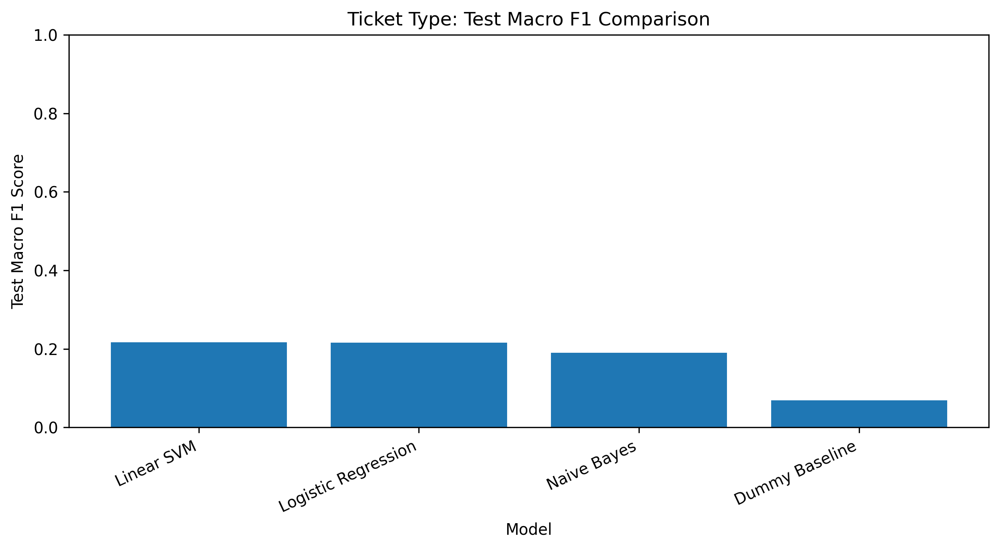
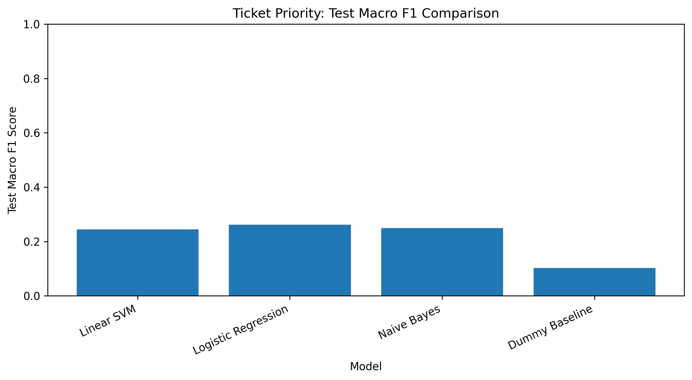
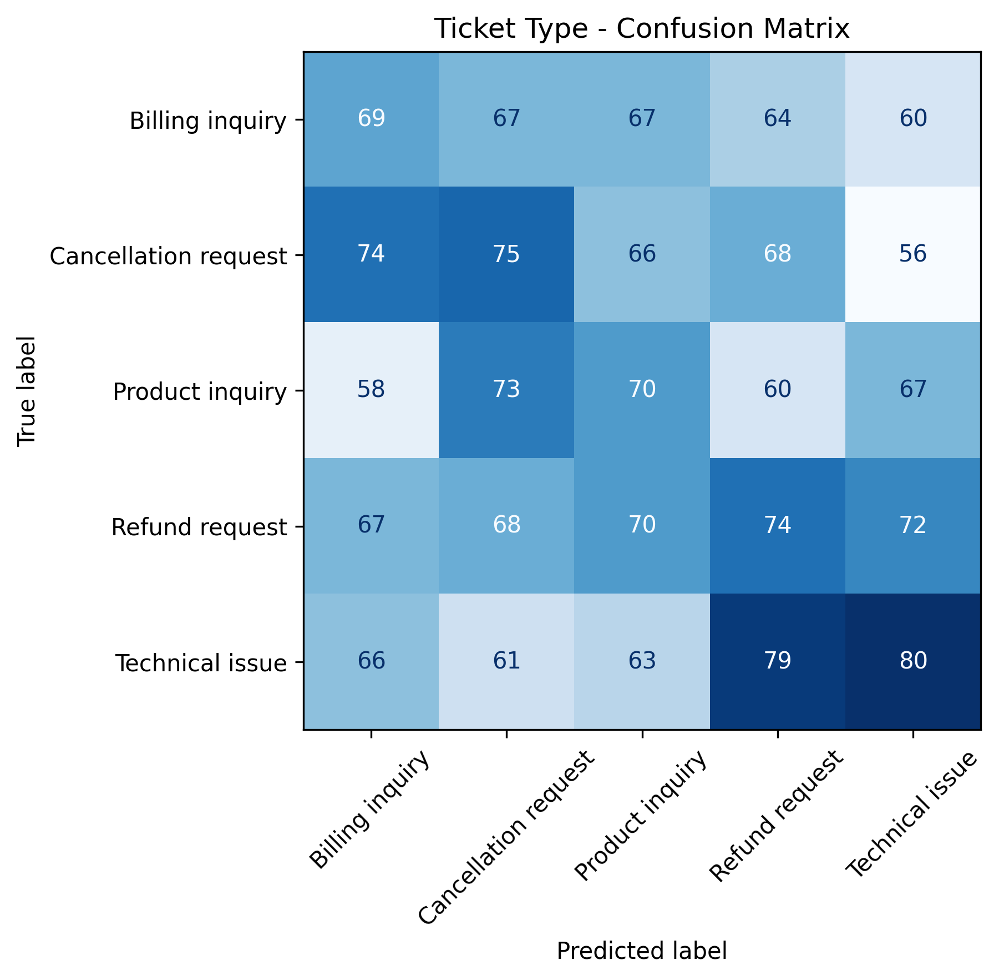
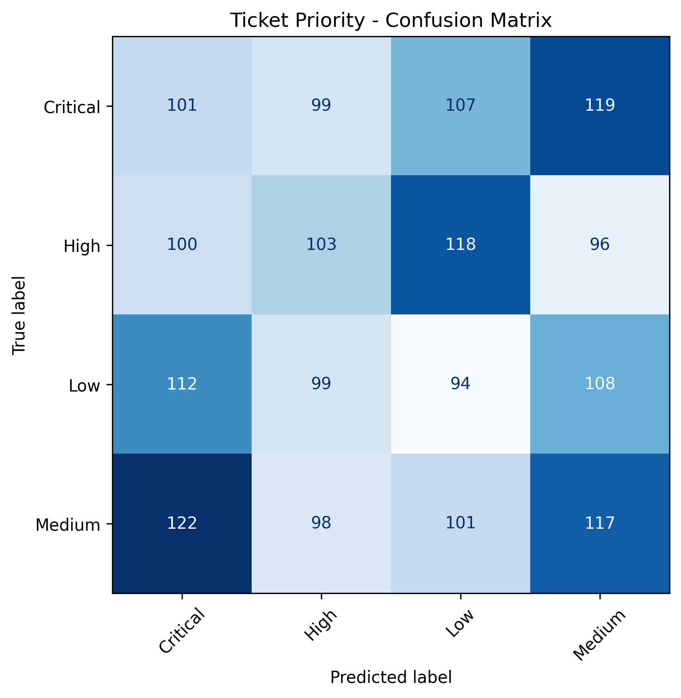
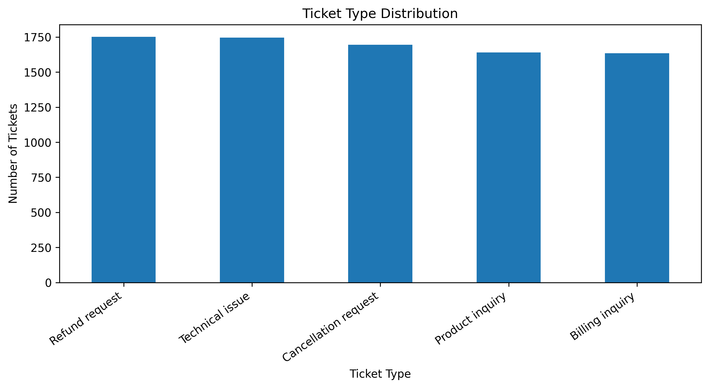
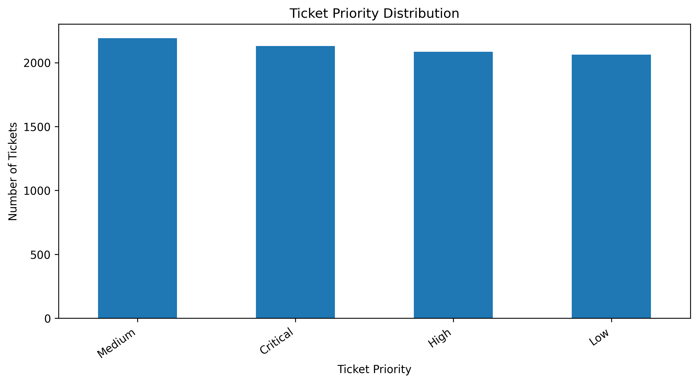

# FUTURE_ML_02 – Support Ticket Classification

A Natural Language Processing (NLP) project that predicts the **type** and **priority** of customer support tickets from their text, using TF-IDF and classical machine learning models.

**Future Interns – Machine Learning Internship | Task 02**

## Project Overview

Support teams receive thousands of tickets about billing, refunds, cancellations, product questions, and technical problems. This project builds a pipeline that reads a ticket's subject and description and tries to predict:

1. **Ticket Type** (5 classes)
2. **Ticket Priority** (4 classes)

Four models are compared against a majority-class baseline, and the best one is chosen using cross-validation.

## Dataset

- **File:** `customer_support_tickets.csv`
- **Size:** 8,469 tickets, 17 columns
- **Input text:** `Ticket Subject` + `Ticket Description` (combined)
- **Targets:** `Ticket Type` and `Ticket Priority`

| Target | Classes |
|---|---|
| Ticket Type | Billing inquiry, Cancellation request, Product inquiry, Refund request, Technical issue |
| Ticket Priority | Low, Medium, High, Critical |

The classes are well balanced (about 1,630–1,750 tickets per type and 2,060–2,190 per priority level).

### Data quality audit

- 144 rows have text that repeats another row after normalising.
- Every ticket description contains an unfilled template placeholder (for example `{product_purchased}`), which suggests the text was generated from templates.

## Tools Used

| Tool | Purpose |
|---|---|
| Python | Programming language |
| Pandas, NumPy | Data handling |
| Scikit-learn | TF-IDF, models, cross-validation, metrics |
| Matplotlib | Charts and confusion matrices |
| Google Colab | Development |

## Project Workflow

1. **Data exploration:** checked columns, missing values, duplicates, and class balance.
2. **Text preparation:** combined subject and description into one text field.
3. **Feature extraction:** TF-IDF with unigrams and bigrams (max 20,000 features).
4. **Model training:** an 80/20 stratified train/test split, with 3-fold cross-validation on the training set.
5. **Models compared:** Dummy Baseline, Logistic Regression, Naive Bayes, Linear SVM.
6. **Model selection:** best model chosen by cross-validated Macro F1 (not by test score).
7. **Evaluation:** accuracy, Macro F1, and confusion matrices on the 1,694 unseen test tickets.

## Results

Selected model for both targets: **Linear SVM**.

| Target | Test Accuracy | Test Macro F1 | Random-guess level |
|---|---|---|---|
| Ticket Type (5 classes) | 21.7% | 0.217 | 20% |
| Ticket Priority (4 classes) | 24.5% | 0.245 | 25% |

### Model comparison (Test Macro F1)

| Model | Ticket Type | Ticket Priority |
|---|---|---|
| Linear SVM | 0.217 | 0.245 |
| Logistic Regression | 0.216 | 0.262 |
| Naive Bayes | 0.191 | 0.249 |
| Dummy Baseline | 0.069 | 0.103 |




### Confusion matrices




### Class distributions




## Key Findings

- All trained models beat the dummy baseline on Macro F1, but **accuracy stays close to random guessing** (about 22% for 5 classes, about 25% for 4 classes).
- The confusion matrices are spread almost evenly across every cell. The model does not clearly separate any category from the others.
- This suggests that, in this dataset, the ticket text carries **little or no signal** about the type or priority labels. The text looks template-generated, and the labels appear unrelated to the wording.
- Because of this, a more complex model is unlikely to help. Better data, with real tickets whose labels match their content, is the more important fix.

## Repository Structure

```text
FUTURE_ML_02_Support_Ticket_Classification/
├── README.md
├── Final_Task02.ipynb
├── final_task02.py
├── customer_support_tickets.csv
├── images/
│   ├── category_confusion_matrix.png
│   ├── category_model_comparison.png
│   ├── priority_confusion_matrix.png
│   ├── priority_model_comparison.png
│   ├── ticket_type_distribution.png
│   └── ticket_priority_distribution.png
├── outputs/
    ├── data_quality_audit.csv
    ├── model_comparison_results.csv
    ├── final_model_summary.csv
    ├── category_classification_report.csv
    └── priority_predictions.csv

```

## How to Run

1. Download or clone this repository.
2. Install the libraries: `pip install pandas numpy scikit-learn matplotlib joblib`
3. Open `final_task02.py` in Google Colab (or convert it to a notebook) and upload `customer_support_tickets.csv`.
4. Update the file path in the `pd.read_csv(...)` line to match where the CSV is saved.
5. Run all cells from top to bottom.

## What I Learned

- Building a TF-IDF text classification pipeline with scikit-learn
- Comparing models with cross-validation and a baseline
- Choosing a model with cross-validation, not the test set, to avoid leakage
- Reading a confusion matrix and spotting when a model is close to guessing
- Auditing data quality, and understanding that a model can only learn what the data contains

## Future Improvements

- Test the pipeline on a real, human-labelled ticket dataset
- Try a transformer model (for example, DistilBERT) on better data
- Use other features such as product, channel, and customer age alongside the text
- Add a simple demo app for predicting a new ticket

## Author

**Tanisha**
BCA Data Science Student
GitHub: [Tanisha82-bit](https://github.com/Tanisha82-bit)

## Internship

Future Interns – Machine Learning Internship, Task 02
